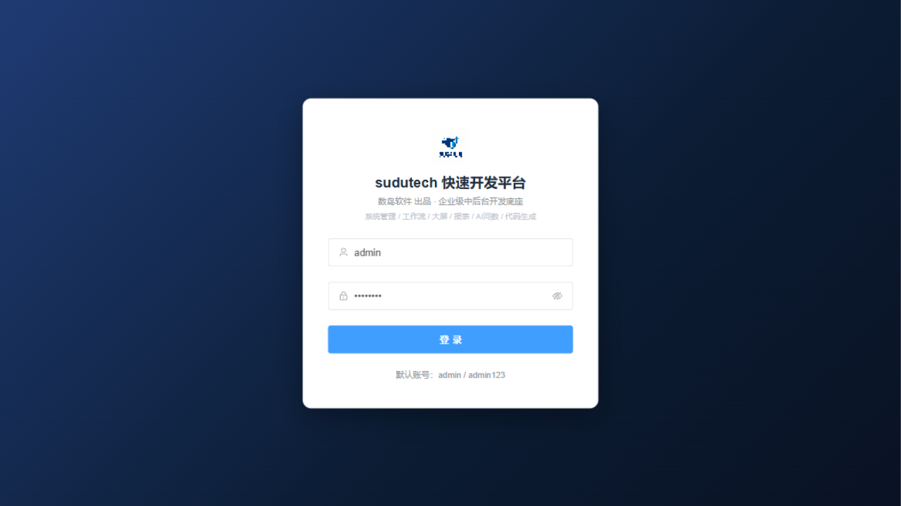
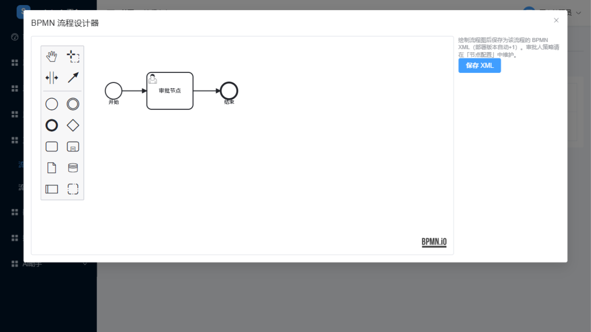

<p align="center">
  
</p>

<h1 align="center">sudutech 快速开发平台</h1>

<p align="center">
  <strong>数岛软件</strong> 出品 · 企业级中后台快速开发底座
</p>

<p align="center">
  
  
  
  
</p>

---

一套功能对标 RuoYi 的企业级中后台开发框架，覆盖后台管理系统通用底座，并在基础能力之上扩展 **工作流可视化设计、大屏可视化拖拽设计、报表设计、自然语言生成 SQL（NL2SQL）** 四大亮点模块。功能集参考若依（RuoYi），代码、表结构与 UI 组件均为全新设计实现。

**默认账号：`admin / admin123`**

## ✨ 功能总览

| 模块 | 能力 |
|------|------|
| 系统管理 | 用户 / 角色 / 菜单 / 部门 / 岗位 / 字典 / 参数 / 通知公告，RBAC 权限模型 + 五档数据权限 |
| 系统监控 | 在线用户（强退）、定时任务（Quartz）、操作日志（AOP）、登录日志 |
| 系统工具 | 代码生成（Velocity 一键生成前后端代码）、多数据源管理（密码 AES 加密） |
| 工作流 | bpmn-js 可视化流程设计器、动态表单（JSON Schema）、节点审批配置（任一/会签）、审批闭环 |
| 数据大屏 | 拖拽设计器、ECharts 组件库、SQL 数据集自动刷新、一键发布匿名分享 |
| 报表中心 | 栅格图表设计器（BAR/LINE/PIE/TABLE/FUNNEL/GAUGE）、SQL 数据集参数绑定 |
| AI 问数 | 火山方舟豆包大模型，自然语言 → SQL → 图表自动推荐（NL2SQL） |

## 🔧 技术栈

| 分类 | 选型 | 说明 |
|------|------|------|
| JDK | OpenJDK 17 LTS | |
| 后端框架 | Spring Boot 3.2.x | Jakarta EE 9+ |
| ORM | MyBatis-Flex 1.8+ | 轻量、国内活跃 |
| 安全认证 | Sa-Token 1.37+ | Bearer Token + Redis 会话 + 注解鉴权 |
| 工作流 | bpmn-js 17 | BPMN 2.0 可视化建模 |
| 缓存 | Redis 7 | 字典/参数缓存（变更主动失效）、登录态 |
| 数据库 | MySQL 5.5+ / 8.0 | utf8mb4，Schema 双版本兼容 |
| 定时任务 | Quartz | Bean 调用，重启自动恢复 |
| 接口文档 | Knife4j 4.x | OpenAPI 3 |
| SQL 安全 | JSqlParser | 只读 SELECT 白名单 |
| 前端框架 | Vue 3.4 + Vite 5 + Element Plus 2 | Composition API + `<script setup>` |
| 图表 | ECharts 5.4+ | |
| AI | 火山方舟 Ark | OpenAI 兼容协议，doubao-pro-32k |

## 🏗️ 项目结构

```
sudutech-server/               后端 Maven 多模块
├── sudutech-common            统一返回体 / 异常 / 注解 / AOP日志 / SQL只读执行引擎 / 动态数据源
├── sudutech-system            用户 / 角色 / 菜单 / 部门 / 岗位 / 字典 / 参数 / 公告 / 日志 / 定时任务
├── sudutech-workflow          流程定义 / 动态表单 / 节点配置 / 简化顺序审批引擎
├── sudutech-screen            大屏项目 / 画布 / 数据集 / 组件注册 / 发布分享
├── sudutech-report            报表页 / 数据集 / 图表 / 执行
├── sudutech-gen               代码生成器（导入表 → 配置 → 预览 → Zip 下载）
├── sudutech-ai                数据源管理 / Schema 采集 / NL2SQL
└── sudutech-admin             启动模块（统一配置、认证接口、在线用户）

sudutech-ui/                   前端（Vite + Vue3 + Element Plus）
└── src/views/                 login / dashboard / system / monitor / gen / workflow / screen / report / ai

sql/                           schema.sql（36 张业务表）+ init-data.sql（初始化数据）
docker/                        Dockerfile-server / Dockerfile-web / nginx.conf / docker-compose.yml
```

## 🚀 快速开始

### 方式一：本机开发

**1. 初始化数据库**（兼容 MySQL 5.5+，推荐 8.0）

```bash
mysql -uroot -p < sql/schema.sql
mysql -uroot -p < sql/init-data.sql
```

**2. 启动后端**（需 JDK 17、Redis、MySQL）

```bash
# 修改 sudutech-server/sudutech-admin/src/main/resources/application-dev.yml
# 填入本机 MySQL / Redis 连接信息（密码建议写在与仓库同级的 application-local.yml，已被 gitignore）
cd sudutech-server
mvn install -DskipTests
java -jar sudutech-admin/target/sudutech-admin.jar
# 接口文档: http://localhost:8080/doc.html
```

**3. 启动前端**（需 Node 18+）

```bash
cd sudutech-ui
npm install
npm run dev
# 访问: http://localhost:5173 （/api 已代理到 8080）
```

### 方式二：Docker 一键部署

```bash
docker compose -f docker/docker-compose.yml up -d --build
# 访问: http://localhost （含 MySQL8 / Redis / MinIO / 后端 / Nginx 前端）
```

## 📸 界面预览

| 登录 | 工作流设计器 |
|------|------|
|  |  |

> 截图文件可自行补充至 `docs/` 目录。

## 🔒 安全说明

- 默认账号 `admin / admin123` 仅用于开发演示，**部署前请立即修改**
- 数据源密码使用 AES 加密存储，默认开发密钥 `sudutech@2026##`，**生产环境务必通过环境变量 `SUDUTECH_AES_KEY` 覆盖**
- 所有默认密码（数据库 / Redis 等）均支持环境变量注入，切勿将真实密码提交到代码仓库（本地私密配置请使用已被 gitignore 的 `application-local.yml`）
- SQL 执行引擎基于 JSqlParser 白名单：仅放行单条 SELECT，强制 LIMIT，拦截 DDL/DML/多语句/文件读写

## 🌍 环境变量

| 变量 | 说明 | 默认值 |
|------|------|--------|
| `ARK_API_KEY` | 火山方舟 API Key（AI 问数必需） | 空（未配置时功能给出明确提示） |
| `ARK_MODEL` | 豆包模型 | `doubao-pro-32k` |
| `SUDUTECH_AES_KEY` | 数据源密码加密密钥 | `sudutech@2026##` |
| `MYSQL_USERNAME` / `MYSQL_PASSWORD` | 数据库账号 | `root` / 空 |
| `REDIS_HOST` / `REDIS_PORT` / `REDIS_PASSWORD` | Redis 连接 | `127.0.0.1` / `6379` / 空 |

## 📋 与设计文档的对应

| 文档章节 | 实现情况 |
|----------|----------|
| 后端 8 模块划分 | ✅ 完全一致（`sudutech-*`） |
| 数据库 36 张业务表 | ✅ 全部落地（`sql/schema.sql`） |
| Sa-Token + JWT 认证 | ✅ Bearer Token + Redis 会话 + 注解鉴权 + 数据权限 |
| 工作流 | ✅ API 契约一致；内置简化顺序审批引擎，Flowable 7 需 MySQL 8 环境可平滑替换 |
| 大屏拖拽设计器 | ✅ 自研鼠标拖拽引擎 + 组件注册表 + 发布态只读渲染 |
| 报表 SQL 数据源 | ✅ JSqlParser 校验 + 强制 LIMIT + 参数绑定 + ECharts dataset |
| NL2SQL | ✅ Schema 注入 + Ark 调用 + JSON 解析 + 图表推荐 |
| 代码生成器 | ✅ Velocity 模板 + Zip 下载 + 在线预览 |
| REST 接口清单 | ✅ 统一前缀 `/api/v1` |
| 部署与安全 | ✅ Docker 多阶段构建 + Compose 编排 + XSS/SQL 注入防护 + 操作审计 |

> **关于工作流引擎**：Flowable 7 的建表脚本依赖 MySQL 8+ 语法（如 `datetime(3)`）。为兼容 MySQL 5.5 开发环境，当前版本内置了基于 `wf_node_config` 的简化顺序审批引擎（REST API 与设计文档一致）；部署于 MySQL 8 时，可引入 `flowable-spring-boot-starter` 将 `WfInstanceService` 实现替换为 Flowable 引擎，`wf_business.process_instance_id` 桥接字段已预留。

## 🤝 参与贡献

欢迎提交 Issue 与 Pull Request！

1. Fork 本仓库，创建特性分支：`git checkout -b feature/your-feature`
2. 提交更改：`git commit -m "feat: 新增xxx"`
3. 推送分支：`git push origin feature/your-feature`
4. 发起 Pull Request

提交信息建议遵循 [Conventional Commits](https://www.conventionalcommits.org/zh-hans/) 规范。

## 📄 开源许可

本项目基于 [MIT License](LICENSE) 开源。

## 🙏 致谢

- [RuoYi](https://gitee.com/y_project/RuoYi) —— 功能设计参考（本项目代码为全新实现，未复制其源码）
- [MyBatis-Flex](https://mybatis-flex.com/) / [Sa-Token](https://sa-token.cc/) / [bpmn-js](https://bpmn.io/) / [ECharts](https://echarts.apache.org/) 等优秀开源项目

---

<p align="center">由 <strong>数岛软件</strong> 维护 · Copyright © 2026 Shudao Software</p>
